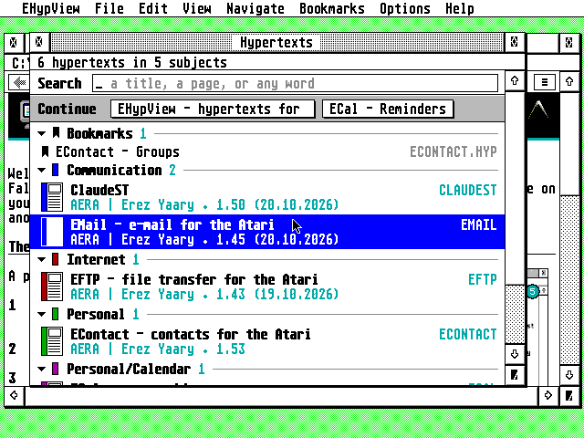
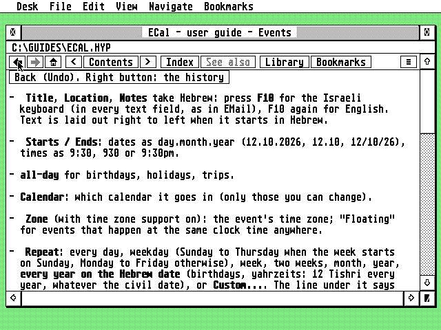
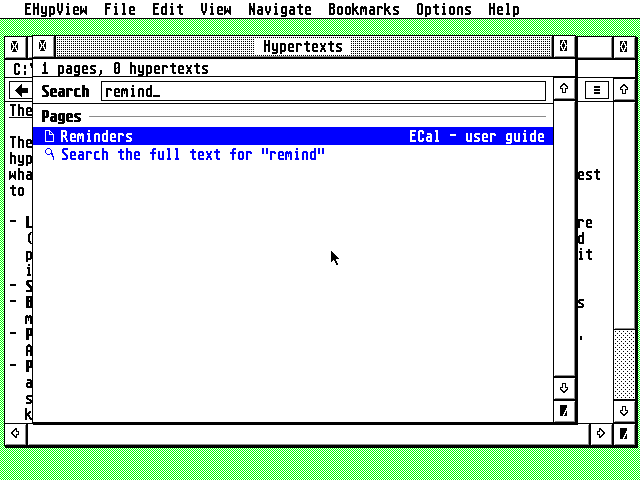

# EHypView


EHypView reads and searches `.HYP` hypertexts, the help that Atari programs come with, on the TT and
Falcon. It runs as a program or as a desk accessory, finds every hypertext on your drives by itself,
and is the help viewer your other programs open when you press Help.

**Highlights**

- **Finds every hypertext by itself:** the folders named in `ST-GUIDE.INF`, and `\GUIDES` and
  `\GEMSYS\GUIDES` on every drive, with all their subfolders, scanned in the background and kept in an
  index. There is no `ALL.REF` to maintain (yours is still read).
- **A library with one search box:** every hypertext found, grouped by subject. Typing finds page
  names, aliases and keywords at once; Return searches the full text of every page of every hypertext.
- **Links that lead somewhere:** into any hypertext in the index, wherever it is. One that leads nowhere
  says so and suggests the closest names ("did you mean").
- **Help for your other programs:** a program that asks for help (`VA_START`, `AC_HELP`) gets its page.
  Installed under the name programs look for, `ST-GUIDE.ACC`, it is found by all of them, and it reads
  the `ST-GUIDE.INF` they share.
- **Pages as they were written:** styled text, links, lines, boxes and images, with unlimited history.
  Pictures and coloured text show in colour in every mode: 4, 16 and 256 colours, high and true
  colour, and black and white on a mono screen. Where the screen has too few colours they are
  dithered, and in ST medium pictures keep their shape.
- **A toolbar:** Back and Forward (with the history on the right button), the main page, the page
  before and after, Contents, Index, See also, the library and bookmarks, each with a tooltip.
- **Several windows and bookmarks:** open a link in a new window (⇧-click) or the page in another
  (^N), up to six; keep pages to come back to (^D), in the Bookmarks menu and the library.
- **Your choice of font:** the system font, or any monospaced GDOS font with NVDI or SpeedoGDOS, in any
  size, changed at any time.
- **Modern but Atari:** a program with a menu bar or a desk accessory, a shortcut for every menu item,
  a right-click menu, drag and drop, the clipboard and iconify.



## Getting started

Download the latest release from **[Releases](https://github.com/whomper/EHypView/releases/latest)**:
each file on its own, and all of them together in `EHYPVIEW-x.y.zip`.

| File | What it is |
|---|---|
| `EHYPVIEW.PRG` | the viewer as a program, with a menu bar |
| `EHYPVIEW.ACC` | the same viewer as a desk accessory (one program under two names) |
| `EHYPVIEW.RSC`, `EHYPVIEW.ICN`, `EHYPVWMK.ICN` | the desktop icon, in the zip's `icons/` folder (see [The desktop icon](#the-desktop-icon)) |
| `EHYPVIEW-x.y.zip` | all of them |

1. Copy `EHYPVIEW.PRG` into a folder of its own (e.g. `C:\EHYPVIEW\`) and start it. It opens the
   hypertext given on its command line, else `DEFHYP` (or `HYPTOP`) from the `ST-GUIDE.INF` in your
   boot drive's root, else the library. To open a `.HYP` with a double-click, install `EHYPVIEW.PRG`
   in your desktop as the application for `HYP` files.
2. To have EHypView inside every program, copy `EHYPVIEW.ACC` to the root of your boot drive and
   restart. **To be the help viewer for every program**, copy it there as `ST-GUIDE.ACC` instead (in
   place of any accessory with that name): that is the name programs look for when you press Help.
3. Keep your hypertexts (each `.HYP` with its `.REF`) where EHypView looks for them, including all
   subfolders:
   - the folders in `PATHS` and `HYPFOLD`, and the folder of `REF`, from `ST-GUIDE.INF`
   - `\GUIDES` and `\GEMSYS\GUIDES` on every drive from C: on

   EHypView looks through these folders in the background, in short steps that pause while you use
   the mouse or keyboard. Its index (`EHYPVIEW.IDX`) has the hypertexts ready without reading them
   again: only new or changed files are read, and when nothing changed nothing is written.
4. Press ^L for the library, Help for the hypertext's help page, and the right mouse button for a menu.

**Needs:** any ST, STE, TT or Falcon, with 1 MB or more (one build for all of them; the FireBee's
own ColdFire build is still to come, see the [roadmap](docs/DESIGN.md#roadmap)); TOS, EmuTOS, MagiC,
or MiNT (MultiTOS, XaAES, N.AES); a screen 640 pixels wide or more. NVDI, SpeedoGDOS or another GDOS
is optional, for more fonts.

## Using the viewer

Click a link, or move to it with Tab and press Return. Links lead into any hypertext in the index, and
when one leads nowhere, the window's info line says so and suggests the closest names. In the program,
every menu item (**Desk**, **File**, **Edit**, **View**, **Navigate**, **Bookmarks**) has a keyboard
shortcut, and items you can't use right now are greyed out. The right mouse button, or Insert, opens a
menu with **Back** and **Forward** first (and, on a link, **Link in new window**), then the pages,
**New window**, **Add bookmark**, **Copy page**, **Library and search**, **Font...**, and
**About EHypView...** last.

**The toolbar**, at the top of each viewer window, drawn like the other AERA programs' toolbars:



| Button | What it does |
|---|---|
| ◀ ▶ | back and forward (the right button: the pages that way, to jump several at once) |
| ⌂ | the main page |
| < Contents > | the page before, the contents, the next page |
| Index | the hypertext's index |
| See also | the pages the page names with `@xref`, as a menu |
| Library | the library: every hypertext found, and the search |
| Bookmarks | add or remove this page, or go to a bookmark |
| ≡ | a menu: **About EHypView...**, new window, open, library, copy, bookmark, fonts, close, quit; the accessory, which has no menu bar, finds them here |

A button that can't be used on the page shown is greyed out, and each one says what it does when the
mouse rests on it for a second. In a narrow window the least needed buttons (See also, Index, ...)
make room first; the ≡ menu and the keys still reach everything.

| Keys | What they do |
|---|---|
| click a link, or Tab / ⇧Tab then Return | follow a link |
| ⇧-click a link, or ⇧Return | follow it in a new window |
| ^N | a new window, with the same page |
| ^D | bookmark the page |
| Backspace, Undo | back |
| ⇧Undo | forward again |
| right mouse button, Insert | the right-click menu |
| Help | the hypertext's help page |
| ^I / ^T | index / contents |
| ^Left / ^Right | previous / next page |
| ^Clr/Home | main page |
| arrows, ⇧arrows | scroll by a line / a page |
| Clr/Home, ⇧Clr/Home | top / bottom |
| ^L | the library (and back to the viewer) |
| ^O | open a hypertext |
| ^C | copy the page, as text, to the clipboard |
| ^W or ^U / ^Q | close the top window / quit |
| ⇧^F | choose the font |
| ^+ / ^- (on the keypad, or ^= and ^-) | larger / smaller text |

**Desk > About EHypView...** shows the version, the number of hypertexts found and the font in use.

**Pop-ups** (links to a `@pnode`) open as a small framed box just below the link, over the page. A
click on a link in the box follows it; any other click, or any key, closes the box and leaves the
page where it was.

**Several windows.** Each viewer window has its own page, history and scroll position; up to six are
open at once, each a little below and right of the last. The menu commands act on the one in front.
A hypertext's "quit" link closes its own window (the program quits with its last one).

**Bookmarks.** **Bookmarks > Add bookmark** (^D) keeps the page shown; the Bookmarks menu lists them
(up to ten) and opens one in the window in front, and **Remove bookmark** forgets the page shown. They
are first in the library too, where the accessory, which has no menu bar, finds them: Return opens
one, Delete removes it. They are kept in `EHYPVIEW.INF` (`BOOKMARK1` to `BOOKMARK10`), which the
program and the accessory share.

Tabs are still to come: [docs/DESIGN.md](docs/DESIGN.md) has the goals and the
[roadmap](docs/DESIGN.md#roadmap).

### The library

**File > Library and search** (^L, or the toolbar's **Library**) lists every hypertext found, grouped
by subject under a heading and a rule, with one search field at the top. Each row has a small picture
of what it is (a book for a hypertext, a ribbon for a bookmark, a page for a page, a magnifier for the
full-text search) and the file or hypertext it is in on the right. It is also what you see when no
page was asked for.



- **Type to search.** Matching page names, aliases and keywords show at once (exact matches first, then
  names starting with what you typed, then names containing it, then similar ones), with matching
  titles.
- **Search the full text.** Return on **Search the full text for "…"** searches every page of every
  hypertext in the background.
- **Bookmarks** come first: all of them with an empty search, the ones whose title or page matches
  while typing.
- **Keys:** Up/Down to choose, Return or a click to open (or to start the full-text search),
  Backspace to delete a letter, Delete to remove the bookmark chosen. ^V pastes into the search and ^X
  cuts it; ^C copies the hypertext chosen. Esc leaves the search as it is: it clears no text, in this
  window or any dialog.

### Fonts

**View > Font...** (⇧^F) chooses the font for the text, with the same font selector as ECal and EMail.
You get the system font in 8×8 or 8×16 and, with NVDI, SpeedoGDOS or another GDOS, every monospaced GDOS
font (bitmap, Speedo, TrueType, Type 1). Hypertexts are laid out in character cells, so proportional
fonts are shown but can't be picked. ^+ and ^- change the size. A font dropped on a window from a font
selector (the font protocol) is used too. Your choice is kept in `EHYPVIEW.INF`, and the list of which
fonts are monospaced in `EHYPVIEW.FNT`.

### Program and accessory

- **The program** has a menu bar, and keeps running when its windows are closed, until you choose
  **File > Quit** (^Q).
- **The accessory** has no menu bar: **About EHypView...** is in the right button's menu. Its entry in
  the Desk menu (**EHypView**) opens the viewer, or the library when no page is shown. It takes its
  memory when it loads: a third of the largest free block (a quarter when there is no TT RAM), at
  most 2 MB, and 64 to 128 KB of ST RAM for the pictures.
- **A quiet start.** At boot the accessory only registers and takes its memory; it reads nothing.
  It reads its index and looks through the library the first time you open it, or a program asks it
  for a page (`START=opened` in `EHYPVIEW.INF`). `START=now` starts at boot, and a number, that many
  seconds after it. Either way it works in short steps between events, never holding the machine for
  long, and waits while you use the mouse or keyboard. A help request naming a file (as the AERA
  programs' Help keys do) is answered at once, without the index.
- **With both installed,** they never work at once. While `EHYPVIEW.PRG` runs, **EHypView** in the
  Desk menu brings the program's window to the front, and a font chosen in the program is the
  accessory's too the next time it opens. Under MagiC or MiNT, where the accessory runs beside the
  programs, starting `EHYPVIEW.PRG` opens the accessory instead.
- **If the program crashes** (what would be 2 to 8 bombs), it says so, writes what happened to
  `CRASH.LOG` next to `EHYPVIEW.PRG` and quits, leaving the Atari running. Under MiNT or MagiC, and in
  the accessory, there is no `CRASH.LOG`.

### With other programs

- **The Help key.** EMail, EFTP, ECal, EContact and ClaudeST open their guides in EHypView with the
  Help key when it runs (as an accessory, or as a program under MultiTOS or MagiC). Any program or
  desktop (Thing, jinnee, Gemini) can hand it a hypertext and a page the same way, with the AV
  protocol's `VA_START`.
- **Drag and drop.** Under MultiTOS, MagiC or XaAES, a hypertext dragged onto EHypView's windows opens.
  The accessory tells the desktop about its windows, so Thing and the like can drop one on them under
  plain TOS too.
- **Iconify.** Where the AES can iconify windows (MultiTOS, MagiC, XaAES, N.AES), the viewer and the
  library have the iconify button: each shrinks to EHypView's icon. A page asked for by another program
  (the Help key) brings the viewer back.

### Where its files are

- **`EHYPVIEW.INF`**, the settings, is in the root of the boot drive, where the accessory always finds
  it. It has a note above each setting, and EHypView keeps the notes, and anything it doesn't know,
  when it writes the file. An `EHYPVIEW.INF` next to the program, from an older EHypView, is copied to
  the root the first time.
- **`FOLDER=`** in it names EHypView's folder, which holds the index of the hypertexts
  (`EHYPVIEW.IDX`) and `EHYPVIEW.FNT`. `EHYPVIEW.PRG` uses the folder it was started from and writes
  it into `FOLDER=`; the accessory uses `FOLDER=`, or the root while there is none.
- **`START=`** says when the accessory starts on its library: `opened` (the first time it is opened
  or asked for a page; the program writes this when there is none), `now`, or seconds after boot.

### The desktop icon

`EHYPVIEW.RSC` is a resource with the icon in monochrome (G_ICON) and 16 colours (G_CICON), each with
its mask: copy them into `DESKICON.RSC` / `DESKCICN.RSC` with a resource editor (Interface, ORCS,
RSM...). `EHYPVIEW.ICN` and `EHYPVWMK.ICN` are the image and its mask in ICN text format. The icon is
the same SM124-style monitor as EMail's, ECal's and EContact's, here showing a hypertext: a page whose
link points to another page.

## Building

```sh
sudo apt install gcc-m68k-linux-gnu zip   # Debian/Ubuntu; no MiNTLib needed
make           # the host tools and tests in build/host, among them hypdump
make atari     # build/hatari/: EHYPVIEW.PRG, EHYPVIEW.ACC, EHVCHECK.PRG;
               # binary/: EHYPVIEW.PRG, EHYPVIEW.ACC
make dist      # dist/: a release's files, each on its own and in EHYPVIEW-x.y.zip
make icons     # draw the icon again (tools/icon/; python3-pil for the PNGs)
```

The Atari programs are built the same way as ECal: with Ubuntu's stock m68k compiler, for the 68000
(so the same files run on every ST, TT and Falcon), and no MiNTLib. GCC 13 joins byte reads into word
reads even for the 68000, which faults on an odd address, so the build turns that pass off
(`-fdisable-tree-bswap`, see the Makefile). `common/atari/` holds a small freestanding runtime (start-up code, libc, GEMDOS
file access, AES/VDI bindings), and `common/tools/elf2tos.py` writes the TOS program file. `common/` is
the AERA programs' shared code, a copy of [AERA-Atari](https://github.com/whomper/AERA-Atari)'s
`common/` folder: change it there and bring the copy up to date with `tools/sync-common.sh`.

`build/host/hypdump` inspects any hypertext:

```sh
build/host/hypdump info  GUIDE.HYP           # header: database, author, subject ...
build/host/hypdump list  GUIDE.HYP           # index table
build/host/hypdump text  GUIDE.HYP [NODE]    # pages as UTF-8 text
build/host/hypdump links GUIDE.HYP [NODE]    # links, see-also, graphics
build/host/hypdump check *.HYP               # decode everything, report damage

# find every hypertext below some folders (with cache and ALL.REF)
build/host/hypdump scan -c guides.idx -r ALL.REF /path/to/guides /more/guides
# where does a link or help request lead?
build/host/hypdump resolve -c guides.idx -f OPEN.HYP xref "AES.HYP/appl_init"
build/host/hypdump resolve -c guides.idx request "'*:\AES.HYP' appl_init"
build/host/hypdump resolve -c guides.idx name appl_init
```

**Versions and releases.** `VERSION` holds the last release, major.minor (e.g. 1.0), and the build
never changes it. Every build shows it as it is in the About box; there is no `-dev` label. `binary/`
and `dist/` are what make builds; they are never committed, and a build changes no tracked file.
Builds between releases are never handed out: to try a change, release it. To release: `tools/bump.py`, commit and push, then **Actions > Release > Run
workflow** on `main` with what is new.
[`.github/workflows/release.yml`](.github/workflows/release.yml) tags the commit (`v1.1`), tests,
builds the programs and publishes each file and the zip as a GitHub Release with those notes. Pushing
a tag `v1.1` made with `git tag -a` does the same, with the tag's message as the notes.

## Source

```
src/core/   the portable core, without GEM: .HYP files and LH5, pages, .REF and
            ST-GUIDE.INF; the folder scanner and the index; links and help requests;
            the full-text search. Built for the Atari and for this computer
src/view/   the viewer and the library without GEM (links, history, search, the
            font setting), tested on this computer
src/gem/    the GEM program: the viewer and library windows, drawing, the menu bar,
            the font selector, the About box
atari/      plat_tos.c: the core's file access on GEMDOS, EHypView's own
common/     the AERA programs' shared code (from AERA-Atari): the TOS runtime,
            AES/VDI, menu bar, About box, alerts, AV protocol, drag and drop,
            iconify, elf2tos.py
icons/      the desktop icon (RSC and ICN files), from tools/icon
tests/      unit and golden tests, fixtures and their generators, EHVCHECK,
            the Hatari rigs
tools/      hypdump, the icon generator, bump.py, sync-common.sh
docs/       DESIGN.md, FORMAT.md, the icon pictures, the screenshots
```

[docs/DESIGN.md](docs/DESIGN.md) has the goals, the design decisions, the architecture and the
roadmap; [docs/FORMAT.md](docs/FORMAT.md) the `.HYP` and `.REF` file formats, with the corrections to
the published description.

## Tests

```sh
make test         # unit and golden tests on this computer
make asan         # the same with AddressSanitizer and UBSan
make m68k-test    # the suite as big-endian 68020 code under QEMU (Linux's libraries need a
                  # 68020; the 68000 is tested in Hatari, on an ST)
                  # (apt install gcc-m68k-linux-gnu qemu-user-static)
make hatari-test  # EHVCHECK.PRG in Hatari, a Falcon and an ST, with EmuTOS (apt install hatari)
make gui-test     # drive EHYPVIEW.PRG in Hatari with the keyboard and mouse
                  # (apt install hatari xvfb xdotool; screenshots in build/gui)
make quiet-test   # the accessory's start and indexing measured in Hatari
make colour-test  # pictures and coloured text in every screen mode, pixel by pixel
```

- **`make test`** runs the unit tests (`tests/test_*.c`: the core, the scanner and index on a real
  folder tree, the viewer, the library, the menu tree, fonts) and the golden tests
  (`tests/run_golden.sh`): the text of the test hypertexts must match `hcp`'s own rendering, an
  independent implementation, and their links, index and header the reviewed files in
  `tests/expected/`.
- **`make m68k-test`** catches byte-order and alignment mistakes before they reach real hardware.
- **`make hatari-test`** runs `EHVCHECK.PRG`, a self-test, not part of the viewer, on a Falcon and on
  a 4 MB ST (whose 68000 faults on a word read at an odd address). It exercises the
  core through GEMDOS on a test folder: scanning, every page and image, links, and the cache. Its
  report must match the same program built for this computer, line for line. To run it on a real
  Atari, copy `build/hatari/` (the program and its `FIXT` folder) to a drive and start
  `EHVCHECK.PRG`.
- **`make gui-test`** drives `EHYPVIEW.PRG` through Hatari's command FIFO: links (also into a
  hypertext three folders down), back, help, the library and both searches, fonts and the font
  selector, the accessory, and the program and accessory side by side. The mouse run (Xvfb and
  xdotool; skipped without them) clicks links, the right button, the menus and the About box. The
  viewer reports what it does through NatFeats, and each step waits for it.
- **`make quiet-test`** boots a Falcon (32 MHz) with the accessory, built with `-DAES_PROFILE`, and a
  library of 60 hypertexts and 6,720 pages, opens it from the Desk menu and boots again. Nothing may
  be read before it is opened, no stretch between its event calls while it reads and indexes may last
  more than 50 ms, and the second boot must find nothing changed and write nothing
  (`tests/run_quiet.py`; the guidelines' 2.2, "A quiet start").

- **`make colour-test`** opens a page of pictures and coloured text in twelve screen modes: the Falcon
  in 4, 16 and 256 colours, ST medium and true colour, the TT in medium, low and high, and an ST of 1
  and 4 MB in high and medium, each in Hatari. It checks every pixel of the pictures, and the text's
  colours, against what the mode's palette should show. Then it opens the front page of each AERA
  program's help, from its latest release (`common/tools/getrelease.py`), on a 1 MB ST and a 1 MB
  Falcon: both pictures must show (`tests/run_colour.py`; screenshots in `build/colour`).

The Hatari rigs fetch EmuTOS 1.4 (the first with true colour on the Falcon) into `build/emutos` the
first time (`tests/emutos.sh`).
[`.github/workflows/ci.yml`](.github/workflows/ci.yml) runs all of the above on every push, and checks
that the build changed no tracked file.

**Test fixtures.** The `.hyp`/`.ref` files in `tests/fixtures` are generated from EHypView's own
sources (`tests/tools/mkfixtures.py`) by `tests/regen.sh /path/to/hcp`, which also writes the
reference output in `tests/expected/`; `common/tools/build-hcp.sh DIR` builds `hcp`.

## Licence

EHypView is free software: you can redistribute it and/or modify it under
the terms of the GNU General Public License as published by the Free
Software Foundation, either version 2 of the License, or (at your option)
any later version. It is distributed in the hope that it will be useful,
but WITHOUT ANY WARRANTY; without even the implied warranty of
MERCHANTABILITY or FITNESS FOR A PARTICULAR PURPOSE. See [COPYING](COPYING).

Copyright (C) 2026 AERA | Erez Yaary.

The test fixtures are compiled with the `hcp` compiler from
[HypView](https://github.com/th-otto/hypview), used as an external tool only. No HypView code is
included in EHypView.

---

Part of **AERA** for Atari: [ECal](https://github.com/whomper/ECal) · [EContact](https://github.com/whomper/EContact) · [EMail](https://github.com/whomper/EMail) · [EFTP](https://github.com/whomper/EFTP) · [EHypView](https://github.com/whomper/EHypView) · [ClaudeST](https://github.com/whomper/ClaudeST) · 8-bit: [EDOS](https://github.com/whomper/EDOS) · [EFTP_XL](https://github.com/whomper/EFTP_XL)
