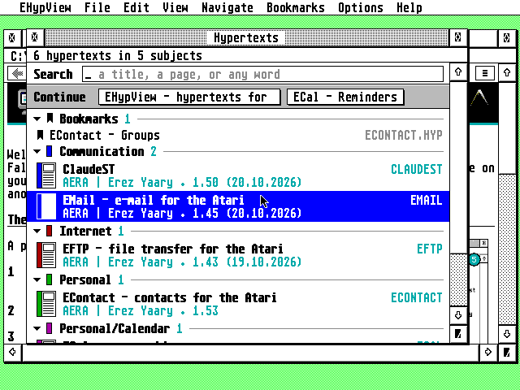

# EHypView


A hypertext viewer for the Atari ST, STE, TT and Falcon: it reads and searches the `.HYP` help that
Atari programs come with, as a program or a desk accessory, and is the viewer they open when you press Help.

**Highlights**

- **Finds every hypertext by itself:** your folders and `ST-GUIDE.INF`'s, `\GUIDES` on every drive, indexed in the background.
- **A library with one search box:** grouped by subject; page names at once, the full text on Return.
- **Links that lead somewhere:** into any hypertext in the index; a broken one suggests the closest names.
- **Help for your other programs:** installed as `ST-GUIDE.ACC`, it answers every program's Help key.
- **Pages as they were written:** styled text, links, lines, boxes and pictures, with unlimited history.
- **Colour in every mode:** 4 to 256 colours, true colour and mono, dithered where colours are few.
- **Tabs, windows and bookmarks:** up to eight tabs a window and six windows; bookmarks on ^D.
- **A toolbar** with tooltips (in BubbleGEM's bubble when it runs), and the history on the right button.
- **Your choice of font:** the system font or any monospaced GDOS font, in any size.
- **Modern but Atari:** program or accessory, right-click menus, drag and drop, the clipboard, iconify.



## Getting started

Download the latest release from **[Releases](https://github.com/whomper/EHypView/releases/latest)**,
each file on its own or all in `ehypview-x.y.zip`:

| File | What it is |
|---|---|
| `ehypview.prg` / `ehypview.acc` | the viewer as a program and as a desk accessory, for every ST, STE, TT and Falcon |
| `ehypview.hyp`, `ehypview.ref` | its guide |
| `icons/` (in the zip) | the desktop icon |

1. Start `EHYPVIEW.PRG` from a folder of its own, or copy `EHYPVIEW.ACC` to the root of the boot drive.
   To be the help viewer for every program, copy the accessory there as `ST-GUIDE.ACC`.
2. Keep your hypertexts (each `.HYP` with its `.REF`) in `\GUIDES`, or add their folders in
   **Options > Settings...**; copy `EHYPVIEW.HYP` and `.REF` there too.
3. Press ^L for the library and Help for the page's help; **Help > EHypView guide** opens the guide.

**Needs:** any ST, STE, TT or Falcon with 1 MB or more; TOS, EmuTOS, MagiC or MiNT; a screen 640
pixels wide (in 320-wide modes only the accessory, for pages other programs ask for). NVDI or another
GDOS is optional, for more fonts.

**Under TOS, put Atari's `FOLDR100.PRG` first in `AUTO`** (renamed `FOLDR400.PRG`): EHypView looks into
every folder of its library, and TOS's folder pool runs out without it.

Everything else (updating, the library, fonts, Settings, the accessory, where its files go):
[docs/USING.md](docs/USING.md).

## Building

```sh
sudo apt install gcc-m68k-linux-gnu zip   # Debian/Ubuntu; no MiNTLib needed
make           # the host tools and tests, hypdump among them
make atari     # binary/EHYPVIEW.PRG and .ACC, for the 68000
make help HCP=/path/to/hcp   # EHYPVIEW.HYP and .REF from docs/GUIDE.md
make dist      # dist/: a release's files and ehypview-x.y.zip
```

Releases, hypdump and the guide: [docs/DEVELOPING.md](docs/DEVELOPING.md).

## Source

```
src/        the core (.HYP files, the index, search), the viewer, and the GEM program
common/     the AERA programs' shared code (from AERA-Atari)
tests/      unit and golden tests, the Hatari rigs
docs/       the guide's source, design, file formats; the rest of this README
```

## Tests

`make test` runs the unit and golden tests on this computer; the Hatari rigs and what each checks are
in [docs/DEVELOPING.md](docs/DEVELOPING.md#tests).

## Licence

GNU General Public License, version 2 or later ([COPYING](COPYING)). Copyright (C) 2026 AERA | Erez Yaary.
The test fixtures are compiled with [HypView](https://github.com/th-otto/hypview)'s `hcp`; none of its code is in EHypView.

---

Part of **AERA** for Atari: [ECal](https://github.com/whomper/ECal) · [EContact](https://github.com/whomper/EContact) · [EMail](https://github.com/whomper/EMail) · [EFTP](https://github.com/whomper/EFTP) · [EHypView](https://github.com/whomper/EHypView) · [ClaudeST](https://github.com/whomper/ClaudeST) · [EWeb](https://github.com/whomper/EWeb) · [EUpdate](https://github.com/whomper/EUpdate) · [EPDF](https://github.com/whomper/EPDF) · 8-bit: [EDOS](https://github.com/whomper/EDOS) · [EFTP_XL](https://github.com/whomper/EFTP_XL) · Gateway: [AERA-Gateway](https://github.com/whomper/AERA-Gateway)
