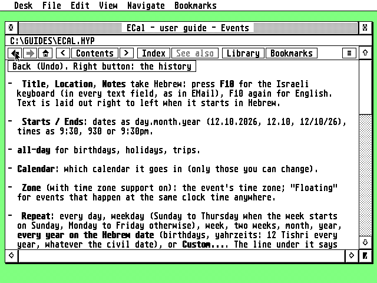
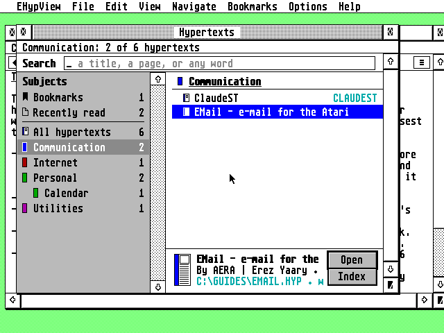
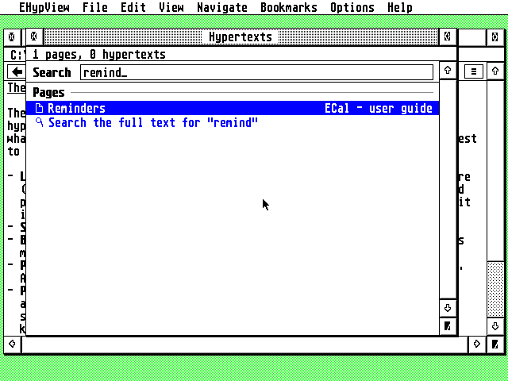
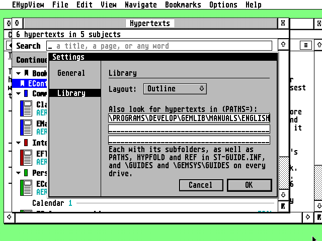

# Using EHypView

The README's [Getting started](../README.md#getting-started) in full, then how the viewer, the library,
fonts, Settings, the accessory and the other programs work. The guide, `EHYPVIEW.HYP` (from
[GUIDE.md](GUIDE.md)), says the same on the Atari.

## Installing

Download the latest release from **[Releases](https://github.com/whomper/EHypView/releases/latest)**:
each file on its own, and all of them together in `ehypview-x.y.zip` (the files are named in lower case on the Releases page).

| File | What it is |
|---|---|
| `EHYPVIEW.PRG` | the viewer as a program, with a menu bar |
| `EHYPVIEW.ACC` | the same viewer as a desk accessory (one program under two names) |
| `EHYPVIEW.HYP`, `EHYPVIEW.REF` | the user guide (and its index for ST-Guide) |
| `EHYPVIEW.RSC`, `EHYPVNV.RSC`, `EHYPVIEW.ICN`, `EHYPVWMK.ICN` | the desktop icon, in the zip's `icons/` folder (see [The desktop icon](#the-desktop-icon)) |
| `ehypview-x.y.zip` | all of them |

1. Copy `EHYPVIEW.PRG` into any folder and start it. It keeps its index (`EHYPVIEW.IDX`), its list
   of fonts (`EHYPVIEW.FNT`) and any `CRASH.LOG` next to itself, so a folder of its own (such as
   `C:\EHYPVIEW\`) keeps them together; its settings, `EHYPVIEW.INF`, go in the root of the boot
   drive. It opens the hypertext given on its command line, else the library. To open a `.HYP`
   with a double-click, install `EHYPVIEW.PRG` in your desktop as the application for `HYP` files.
2. To have EHypView inside every program, copy `EHYPVIEW.ACC` to the root of your boot drive and
   restart. **To be the help viewer for every program**, copy it there as `ST-GUIDE.ACC` instead (in
   place of any accessory with that name): that is the name programs look for when you press Help.
3. Keep your hypertexts (each `.HYP` with its `.REF`) where EHypView looks for them, including all
   subfolders:
   - the folders you add in **Options > Settings...** (`PATHS` in `EHYPVIEW.INF`)
   - the folders in `PATHS` and `HYPFOLD`, and the folder of `REF`, from `ST-GUIDE.INF`
   - `\GUIDES` and `\GEMSYS\GUIDES` on every drive from C: on

   Copy `EHYPVIEW.HYP` and `EHYPVIEW.REF` into one of them too (or next to `EHYPVIEW.PRG`): **Help >
   EHypView guide** opens it.

   EHypView looks through these folders in the background, in short steps that pause while you use
   the mouse or keyboard. Its index (`EHYPVIEW.IDX`) has the hypertexts ready without reading them
   again: only new or changed files are read, and when nothing changed nothing is written. The
   pages' names stay in it, on the disk, and are read when a link or a search needs them.
4. Press ^L for the library, Help for the hypertext's help page (in the library, EHypView's guide),
   ^, for the settings, and the right mouse button for a menu.

**To update,** copy the new files over the old ones. `EHYPVIEW.INF`, with your settings and bookmarks,
and the index stay; an index from an older EHypView that the new one can't read is made again.

**Needs:** any ST, STE, TT or Falcon, with 1 MB or more (one build for all of them; the FireBee's
own ColdFire build is still to come, see the [roadmap](DESIGN.md#roadmap)); TOS, EmuTOS, MagiC,
or MiNT (MultiTOS, XaAES, N.AES); a screen 640 pixels wide or more (in ST low and other screens 320
pixels wide, the accessory still shows the pages other programs ask for, but doesn't open from the
Desk menu). NVDI, SpeedoGDOS or another GDOS is optional, for more fonts. On a 1 MB ST the accessory
also loads beside ECal's or EContact's (the ST editions), with less memory of its own (64 to 105 KB
instead of 160 KB). Of those two, only one fits on a 1 MB ST.

**Under TOS, put Atari's `FOLDR100.PRG` first in `AUTO`**, renamed for more room (`FOLDR400.PRG`).
TOS keeps an entry in a small internal pool for every folder a program or accessory has looked
into, and halts with "OUT OF INTERNAL MEMORY" when it runs out; FOLDRxxx makes the pool bigger.
EHypView looks into every folder of its library, with their subfolders, when it makes its index.

## Using the viewer

Click a link, or move to it with Tab and press Return. Links lead into any hypertext in the index, and
when one leads nowhere, the window's info line says so and suggests the closest names. The program's
menus are **EHypView** (where other programs have Desk), **File**, **Edit**, **View**, **Navigate**,
**Bookmarks**, **Options** and **Help**; most items have a key, shown beside them, and items you
can't use right now are greyed out. The right mouse button, or Insert, opens a
menu with **Back** and **Forward** first (and, on a link, **Link in new window** and **Link in new
tab**), then the pages,
**New window**, **Add bookmark**, **Copy page**, **Library and search**, **Font...**, and
**About EHypView...** last.

**The toolbar**, at the top of each viewer window, drawn like the other AERA programs' toolbars:

| Button | What it does |
|---|---|
| ◀ ▶ | back and forward (the right button: the pages that way, to jump several at once) |
| ⌂ | the main page |
| < Contents > | the page before, the contents, the next page |
| Index | the hypertext's index |
| See also | the pages the page names with `@xref`, as a menu |
| Library | the library: every hypertext found, and the search |
| Bookmarks | add or remove this page, or go to a bookmark |
| ≡ | a menu: **About EHypView...**, new window, open, library, copy, bookmark, fonts, settings, the guide, close, quit; the accessory, which has no menu bar, finds them here |

A button that can't be used on the page shown is greyed out, and each one says what it does when the
mouse rests on it for a second, in BubbleGEM's bubble when BubbleGEM runs. In a narrow window the
least needed buttons (See also, Index, ...) make room first; the ≡ menu and the keys still reach
everything.

**Tabs.** ^-click a link, or ^Return on the one chosen, and it opens in a new tab of the same
window, in front, with its own Back and Forward. With two tabs or more a strip of them shows under
the toolbar: click one, or ^Tab / ⇧^Tab, to bring it to the front. ^U and the window's closer close
the tab in front (the window with its last), and a tab's right button has **Close tab** and **Close
other tabs**. Up to eight in a window; a tab not in front keeps only its place and history, its page
read again when it comes back, and a title cut short shows whole when the mouse rests on it. Tabs
aren't kept when the window closes.

| Keys | What they do |
|---|---|
| click a link, or Tab / ⇧Tab then Return | follow a link |
| ⇧-click a link, or ⇧Return | follow it in a new window |
| ^-click a link, or ^Return | follow it in a new tab |
| ^Tab / ⇧^Tab | the next tab / the one before |
| ^N | a new window, with the same page |
| ^D | bookmark the page |
| Backspace, Undo | back |
| ⇧Undo | forward again |
| right mouse button, Insert | the right-click menu |
| Help | the hypertext's help page (in the library: EHypView's guide) |
| ^I / ^T | index / contents |
| ^Left / ^Right | previous / next page |
| ^Clr/Home | main page |
| arrows, ⇧arrows | scroll by a line / a page |
| Clr/Home, ⇧Clr/Home | top / bottom |
| ^L | the library (and back to the viewer) |
| ^O | open a hypertext |
| ^C | copy the page, as text, to the clipboard |
| ^U / ^Q | close the top window / quit |
| ^W | the next window on top, in turn |
| ⇧^F | choose the font |
| ^+ / ^- (on the keypad, or ^= and ^-) | larger / smaller text |
| ^, | settings |

**EHypView > About EHypView...** (the first menu, where other programs have Desk) shows the version
and the family's status lines (guidelines 1.3): the hypertexts found and the font in use, then the
memory (`about_mem_line`, `common/ui/aboutline.c`); EHypView has no connection line.

**Pop-ups** (links to a `@pnode`) open as a small framed box just below the link, over the page. A
click on a link in the box follows it; any other click, or any key, closes the box and leaves the
page where it was.

**Several windows.** Each viewer window has its own page, history and scroll position; up to six are
open at once, each a little below and right of the last. The menu commands act on the one in front.
A hypertext's "quit" link closes its own window (the program quits with its last one).

**Bookmarks.** **Bookmarks > Add bookmark** (^D) keeps the page shown; the Bookmarks menu lists them
(up to ten) and opens one in the window in front, and **Remove bookmark** forgets the page shown. They
are first in the library too, where the accessory, which has no menu bar, finds them: Return opens
one, Delete removes it. They are kept in `EHYPVIEW.INF` (`BOOKMARK1` to `BOOKMARK10`), which the
program and the accessory share.

Tabs are still to come: [docs/DESIGN.md](DESIGN.md) has the goals and the
[roadmap](DESIGN.md#roadmap).

### The library

**File > Library and search** (^L, or the toolbar's **Library**) lists every hypertext found, grouped
by subject, with one search field at the top. Each subject has its colour; each row has a small
picture of what it is (a book for a hypertext, its spine in the subject's colour, a ribbon for a
bookmark, a page for a page, a magnifier for the full-text search). It is also what you see when no
page was asked for, and it opens with what was found before (`EHYPVIEW.IDX`) while EHypView looks
for new hypertexts. A subject with a part (`Personal/Calendar`) comes under its subject: Calendar,
under Personal. `Documentation/` or `Dokumentation/` in front is left out, as it says nothing of
what a hypertext is about: `Documentation/Editors` is Editors. Settings chooses one of two layouts
(`LIBRARY=`):

- **Outline**, the first one. Under the search field, **Continue**: a button for each page you read
  last (one for each hypertext, the newest first). Then Bookmarks and one group for each subject,
  each heading with the subject's colour, the number of hypertexts in it and a triangle: a click on
  it, or Return, folds the group; Left and Right fold and open it from the keyboard. A hypertext takes
  two lines, its title over its author and version, with the file on the right.
- **Two panes.** The subjects on the left (Bookmarks, Recently read, All hypertexts, each subject),
  scrolling on their own with a bar of AES objects at their right, so it takes the AES's look
  (guidelines 5.1, `common/ui/panebar.c`); the hypertexts of the one chosen on the right, and under them what the row chosen is: its title, author
  and version, the file and its `.REF`, with **Open** and **Index** (the AES's own buttons). Left or
  Tab goes to the subjects, Right, Tab or Return back to the rows. The edge between the panes can be
  dragged; the width is kept (`PANECOLS=`). A window narrower than 56 characters shows the Outline.
- **Your own subjects.** A hypertext's `@subject` is only where it starts: the library's index,
  `EHYPVIEW.IDX`, is where it belongs. Drag a hypertext onto another subject (the Subjects pane, or
  a heading in the Outline) to file it there, or use **File under...** in its right-button menu;
  **Rename subject...** renames a subject or a part for all its hypertexts. The right button
  chooses and shows the menu, it never opens. The index changes and is written again in short
  steps; the `.HYP` files are never written. A rescan keeps the subject the index has for every
  hypertext it knows, changed or moved to another folder; only a new one takes its own @subject
  (`src/core/scan.c`, `src/view/library.c`).

The pages read last are written to `EHYPVIEW.INF` (`RECENT1=`...) when a viewer window closes and
when EHypView ends, not at every page.

- **Type to search.** Matching page names, aliases and keywords show at once (exact matches first, then
  names starting with what you typed, then names containing it, then similar ones), with matching
  titles.
- **Search the full text.** Return on **Search the full text for "…"** searches every page of every
  hypertext in the background.
- **Bookmarks** come first: all of them with an empty search, the ones whose title or page matches
  while typing.
- **Keys:** Up/Down to choose, Return or a click to open (or to start the full-text search),
  Backspace to delete a letter, Delete to remove the bookmark chosen. ^V pastes into the search and ^X
  cuts it; ^C copies the hypertext chosen. Esc empties the search, as GEM's fields, and does nothing
  else: the window stays (guidelines 3.5).

### Fonts

**View > Font...** (⇧^F) chooses the font for the text, with the AERA programs' Font dialog
(common/ui/fontsel.c), the same as ECal's and EMail's: the families on the left, the styles and the
sizes beside them, the kind of font, and a sample. It lists the system font in 8×8
or 8×16 and, with NVDI, SpeedoGDOS or another GDOS, every fixed-width GDOS font with letters (bitmap,
Speedo, TrueType, Type 1). Hypertexts are laid out in character cells, so proportional fonts and fonts
of symbols are left out. ^+ and ^- change the size. A font dropped on a window from a font selector
(the font protocol) is used when the dialog would list it. Your choice is kept in `EHYPVIEW.INF`, and
which fonts can be used in `EHYPVIEW.FNT`.

The accessory loads GDOS fonts only when the Atari starts, as every AERA accessory does: GDOS fonts
loaded later would be lost when the program in front ends. Under NVDI it always loads them, so its
Font dialog lists the same fonts as the program and a font chosen is used at once. Under FONTGDOS or
SpeedoGDOS it loads them only when `EHYPVIEW.INF` names one, to spare a 1 MB ST their memory: there a
GDOS font chosen in the accessory, or in the program while the accessory is loaded, is used by the
accessory from the next boot, and its Font dialog lists the ones it knows "from the next start".

### Settings

**Options > Settings...** (^,; in the accessory, the toolbar's ≡ menu) shows what `EHYPVIEW.INF` holds,
on two pages, as EMail's and ECal's Settings do. OK keeps the changes; Cancel, Undo and Esc forget them
(in a folder's field Esc empties the field instead, guidelines 3.5).

- **General:** when the accessory looks through the library (`START=`): when first opened, at start,
  after a minute or after 5 minutes, from a pop-up that opens over its button; EHypView's folder
  (`FOLDER=`), where the index is kept. Dialogs and alerts are in 3D wherever the AES draws it (TOS 4,
  MagiC, N.AES, XaAES, EmuTOS in colour), with no setting for it (guidelines 5.6, `common/ui/dialog.c`);
  a `DIALOGS3D=` line left from 1.25 to 1.28 is ignored and left out when the file is next written.
- **Library:** its layout, Outline or Two panes (`LIBRARY=`); up to three more folders to look for
  hypertexts in, with their subfolders (`PATHS=`). Each field holds a path of up to 128 characters,
  more than it shows (guidelines 5.4, `common/ui/field.c`). A folder that isn't there is asked about: **Keep**
  it (a drive put in later) or **Change** it. OK with new folders looks through the library again.

The font stays in **View > Font...**, as in ECal and EMail, and the bookmarks in the Bookmarks menu.

### Program and accessory

- **The program** has a menu bar, and keeps running when its windows are closed, until you choose
  **File > Quit** (^Q).
- **The accessory** has no menu bar: its commands are in the toolbar's ≡ menu, and **About
  EHypView...** in the right button's menu too. Its entry in
  the Desk menu (**EHypView**) opens the viewer, or the library when no page is shown. It takes its
  memory when it loads, as every AERA accessory does (common/ui/accmem.c): the first time 160 KB
  (2 MB in TT RAM), never more than a quarter of what is free where 1 MB or more is, else half;
  after that what it measured it needs (`MEMKB=`), or what you set (`HEAPKB=`). Where its memory
  is TT RAM, 64 to 128 KB of ST RAM for the pictures as well; else the pictures come from its
  memory.
- **A quiet start.** At boot the accessory only registers and takes its memory; it reads nothing.
  It reads its index and looks through the library the first time you open it, or a program asks it
  for a page (`START=opened` in `EHYPVIEW.INF`). `START=now` starts at boot, and a number, that many
  seconds after it. Either way it works in short steps between events, never holding the machine for
  long, and waits while you use the mouse or keyboard. A help request naming a file (as the AERA
  programs' Help keys do) is answered at once, without the index.
- **With both installed,** they never work at once. While `EHYPVIEW.PRG` runs, **EHypView** in the
  Desk menu brings the program's window to the front, and a font chosen in the program is the
  accessory's too the next time it opens. Under MagiC or MiNT, where the accessory runs beside the
  programs, starting `EHYPVIEW.PRG` opens the accessory instead.
- **If the program crashes** (what would be 2 to 8 bombs, or 11 for an FPU instruction on an Atari
  without one), it says so, writes what happened to `CRASH.LOG` next to `EHYPVIEW.PRG` and quits,
  leaving the Atari running. When TOS shows the bombs instead, and they went off in EHypView, the next
  start finds TOS's record of them, adds it to `CRASH.LOG` and offers to show it.
  Under MiNT or MagiC, and in the accessory, there is no `CRASH.LOG`.

### With other programs

- **The Help key.** EMail, EFTP, ECal, EContact and ClaudeST open their guides in EHypView with the
  Help key when it runs (as an accessory, or as a program under MultiTOS or MagiC): they look for
  the viewer `STGUIDE` names first, then EHypView, ST-Guide and HypView. Any program or desktop
  (Thing, jinnee, Gemini) can hand it a hypertext and a page the same way, with the AV protocol's
  `VA_START`, or as ST-Guide is asked, with `AC_HELP`.
  Under MiNT and MagiC, when no viewer runs, their Help key starts `EHYPVIEW.PRG` beside them with the
  hypertext and page on its command line (`common/ui/help.c`), found by `FOLDER=` in `EHYPVIEW.INF`,
  which the program writes: so it needs to have run once. EHypView reads its command line the ARGV
  way too (`cmd_line()`, `common/atari/tos.c`), as MiNT and MagiC pass it.
- **Another viewer.** Users of another hypertext viewer name it in the AES's environment as
  `STGUIDE` (`setenv STGUIDE C:\HYPVIEW\HYPVIEW.APP` in `XAAES.CNF`, `#_ENV STGUIDE=...` in `MAGX.INF`),
  as ST-Guide started the custom: the AERA programs' Help key asks that viewer first and, under MiNT
  and MagiC, starts it rather than EHypView when none runs (guidelines 4.3, `common/ui/help.c`).
- **The clipboard.** ^C copies the page shown, as text, to the GEM clipboard (`SCRAP.TXT`); in the
  library ^C copies the hypertext chosen, and ^V and ^X paste into and cut the search.
- **Drag and drop.** Under MultiTOS, MagiC or XaAES, a hypertext dragged onto EHypView's windows opens.
  The accessory tells the desktop about its windows, so Thing and the like can drop one on them under
  plain TOS too.
- **Dialogs and alerts under MiNT and MagiC.** Where the AES runs several programs at once (MiNT with
  XaAES, N.AES or MyAES; MagiC), EHypView's alerts are the AES's own, and its dialogs (Settings, Font,
  About) open in windows with their own names: they can be moved, the closer works as Undo, and other
  programs go on running meanwhile. Under TOS and EmuTOS they are drawn over the screen as before
  (`common/ui/dialog.c`).
- **Iconify.** Where the AES can iconify windows (MultiTOS, MagiC, XaAES, N.AES), the viewer and the
  library have the iconify button: each shrinks to EHypView's icon. A page asked for by another program
  (the Help key) brings the viewer back.

### Where its files are

- **`EHYPVIEW.INF`**, the settings, is in the root of the boot drive, where the accessory always finds
  it. Each setting has a note above it and an empty line after it, and EHypView keeps the notes, and
  anything it doesn't know, when it writes the file. An `EHYPVIEW.INF` next to the program, from an older EHypView, is copied to
  the root the first time.
- **`FOLDER=`** in it names EHypView's folder, which holds the index of the hypertexts
  (`EHYPVIEW.IDX`) and `EHYPVIEW.FNT`. `EHYPVIEW.PRG` uses its own folder and writes
  it into `FOLDER=`; the accessory uses `FOLDER=`, or the root while there is none.
- **`START=`** says when the accessory starts on its library: `opened` (the first time it is opened
  or asked for a page; the program writes this when there is none), `now`, or seconds after boot.
- **`PATHS=`** names more folders to look for hypertexts in, between `;`, as well as `ST-GUIDE.INF`'s.
- **`MEMKB=`** is the memory the accessory takes at boot, in KB, as it measured it once its library
  was read (written again when that moves by more than an eighth): its index, and what its pages
  needed, **`PAGEKB=`**, 64 KB until a viewer window closes having needed more (then both grow).
  **`HEAPKB=`**, when you add it, is taken instead.
  `ST-GUIDE.INF` itself is ST-Guide's: EHypView reads it and never writes it.

**Settings** changes `START=` and `PATHS=`.

### The desktop icon

The icon is a lifebuoy, for help, drawn like the other AERA programs' icons (the AERA guidelines,
5.5). `EHYPVIEW.RSC` is a resource with it in monochrome (G_ICON, for TOS 1 and 2) and as a colour
icon (G_CICON) in black and white, 16 and 256 colours, each with its mask and its selected image:
copy them into `DESKICON.RSC` / `DESKCICN.RSC` with a resource editor (Interface, ORCS, RSM...), or
use it as it is in Thing or Teradesk. `EHYPVIEW.ICN` and `EHYPVWMK.ICN` are the image and its mask in
ICN text format.

Which RSC to take: the desktop draws an icon's pixels straight as colour registers, and NVDI's own
256 colours are not TOS's.

- `EHYPVIEW.RSC` under TOS, EmuTOS, or NVDI with TOS's palette loaded (COLORVDI.CPX);
- `EHYPVNV.RSC` under NVDI with its own palette: the same icon, its 256-colour image on NVDI's
  colours.

